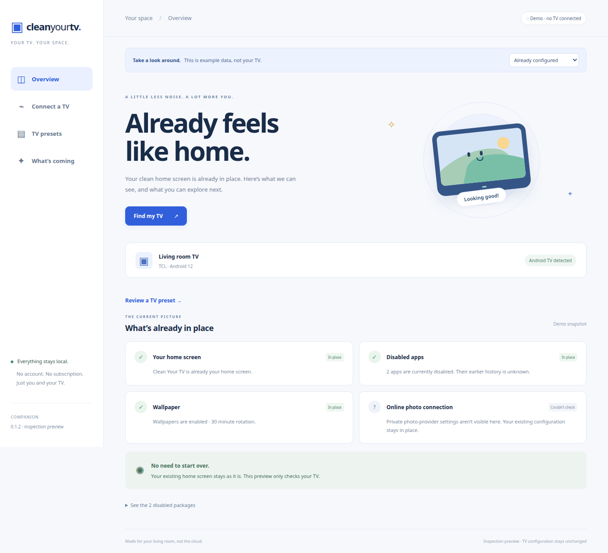
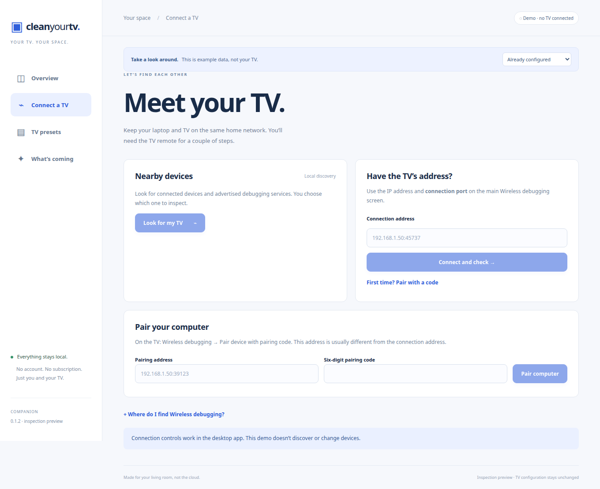
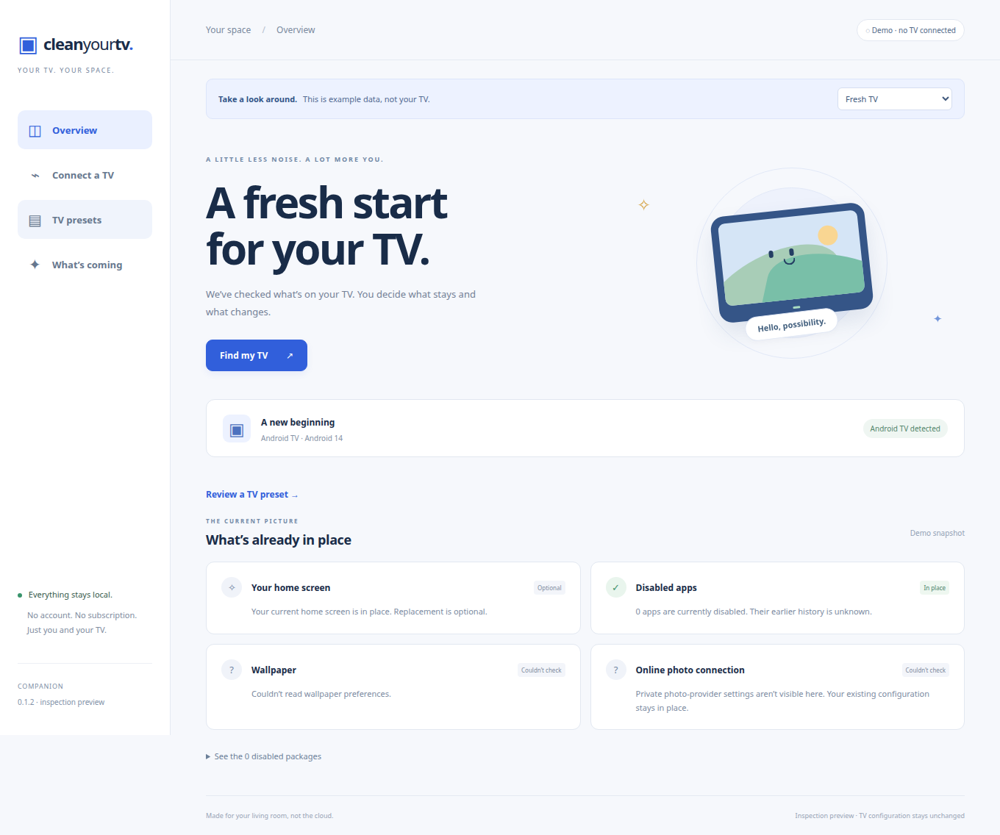
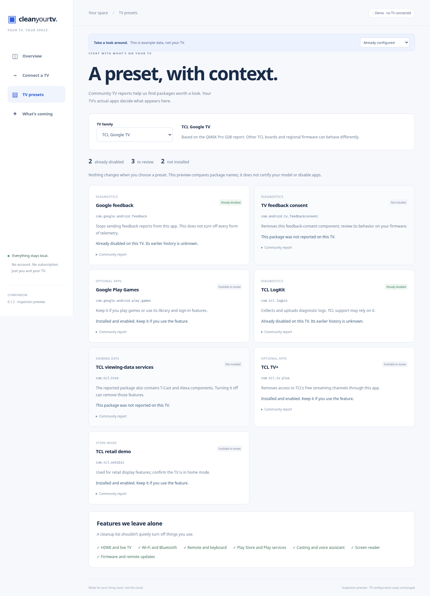
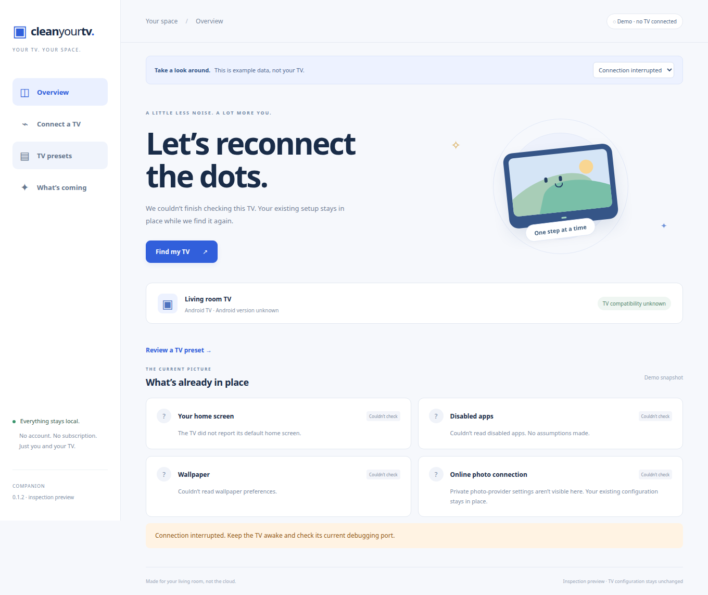

# Clean Your TV Companion

Find your Android TV, connect it to your laptop, and see what’s already set up.

A desktop app for Windows, macOS and Linux. Runs locally, with no account, AI service or subscription.

**[Download the preview](https://github.com/gethari/clean-your-tv-companion/releases)** · [Setup help](docs/TESTING.md) · [Roadmap](plans/companion.md)



This grew out of setting up a TCL Google TV. The connection port kept changing, some apps were already disabled, and the TV reported its model as “Smart TV Pro.” We wanted an app that could check the actual TV and explain the next step without a terminal or coding assistant.

**The preview connects and inspects.** It can pair your computer, read the TV’s current setup, and compare installed apps with community presets. Installing a launcher, disabling apps and restoring changes are still on the [roadmap](plans/companion.md).

## Get started

1. [Download a build](https://github.com/gethari/clean-your-tv-companion/releases) for your computer and open it. Android tools are included.
2. Keep the computer and TV on the same home network. Enable **Wireless debugging** in the TV’s developer options.
3. Choose **Find my TV**. If it doesn’t appear, enter the address shown on the TV.
4. Pair the computer when asked. The app then looks for the connection address and checks your setup.

The pairing port and connection port are different. If the TV sleeps or reconnects to Wi-Fi, check its current address before trying again. The app has instructions for finding these settings.

| Computer | Download |
| --- | --- |
| Windows x64 | Setup `.exe` |
| Linux x64 | `.AppImage` or `.deb` |
| macOS, Apple silicon | `.dmg` |

These are unsigned preview builds, so Windows or macOS may show a publisher warning. Intel Mac builds aren’t published yet. See [platform notes](docs/TESTING.md) if you get stuck opening the app.

You can also choose **Try the demo** and look around without connecting a TV. All screenshots here use labeled example data.

## Pair once, then connect

Enter the pairing address and six-digit code from the TV. After pairing, the app connects automatically when it finds one matching address. If several addresses appear, it asks for the current connection port instead of choosing one for you.



## Already set up your TV?

The overview recognizes an active Clean Your TV launcher and shows packages that are already disabled. It reads wallpaper preferences where available and leaves private settings alone.

A failed check stays marked **Couldn’t check**. It doesn’t turn into a suggestion to reinstall something or start over.

<details>
<summary>See the fresh-TV view</summary>



</details>

## TV presets

Choose **TV presets** to compare your TV with reports from TCL, Xiaomi/Redmi, Sony, Hisense and Philips owners. There’s also a shared Android TV / Google TV list.

Each entry shows the package name, what it does, what you might lose by turning it off, and the model and firmware of the source report. The app separates **Already disabled**, **Available to review** and **Not installed**. Choosing a preset doesn’t change anything on the TV.



Two TVs from the same brand can ship with different software. These lists help you review what’s installed; they aren’t a claim that every model has been tested. Core remote, input, network, accessibility and update services are kept. Packages that bundle casting or voice features need a separate review. [Read the preset sources and rules](docs/PRESETS.md).

## When the connection drops

Keep the TV awake and check the address on its Wireless debugging screen. You can reconnect without repeating setup. Pair again only if the computer’s authorization was removed.



<details>
<summary>Windows upgrade reports AdbWinUsbApi.dll is in use</summary>

Older previews could leave their bundled ADB process running after the window closed. The 0.1.2 installer asks Windows to close the app and Android tools loaded from its install folder before replacing files. It does not stop every ADB process on the computer.

If an older installer is already stuck, cancel it, restart Windows, and run the new installer. Your TV’s existing pairing authorization does not need to be removed.

</details>

## Supported TVs

The first target is **Android TV and Google TV with ADB access**. Some firmware restricts debugging, app installation or changing the home screen. The app checks what it can read; a brand name alone isn’t proof of compatibility.

Samsung Tizen, LG webOS, Hisense VIDAA and Fire TV aren’t supported in this preview. See the [known caveats](docs/CAVEATS.md) for the device-specific details collected so far.

## Working on the app

Built with Tauri 2, Rust, Svelte and TypeScript. Use **pnpm**. Desktop development also needs Rust and the [Tauri prerequisites](https://v2.tauri.app/start/prerequisites/).

```sh
pnpm install --frozen-lockfile
pnpm dev          # browser demo
pnpm tauri dev    # desktop app
```

For local desktop development, set `CYTV_ADB_PATH` to your ADB executable, or run `python3 scripts/fetch-adb.py` to prepare the bundled tools.

```sh
pnpm check
pnpm test
pnpm exec playwright test
pnpm screenshots  # refresh the README images using demo data
```

[Contributing](CONTRIBUTING.md) · [Product scope](docs/PRODUCT.md) · [Architecture](docs/ARCHITECTURE.md) · [Design](docs/DESIGN.md)

Inspired by [Gathin23/cleanyourtv](https://github.com/Gathin23/cleanyourtv). This companion is a separate project. MIT licensed.
